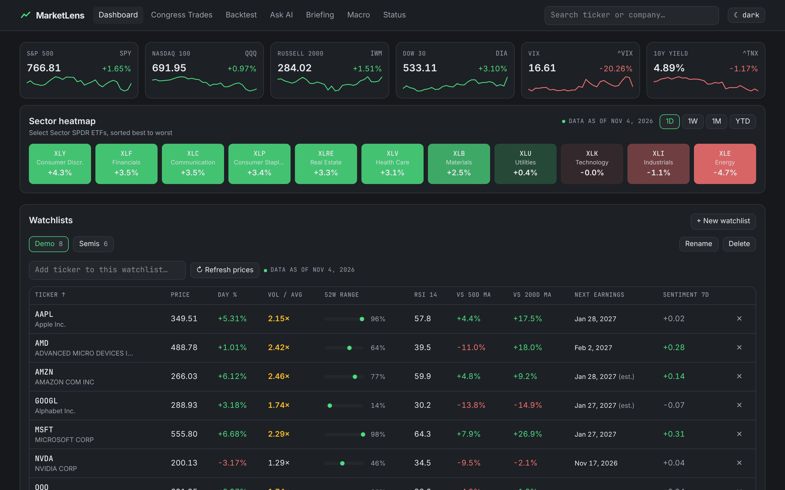
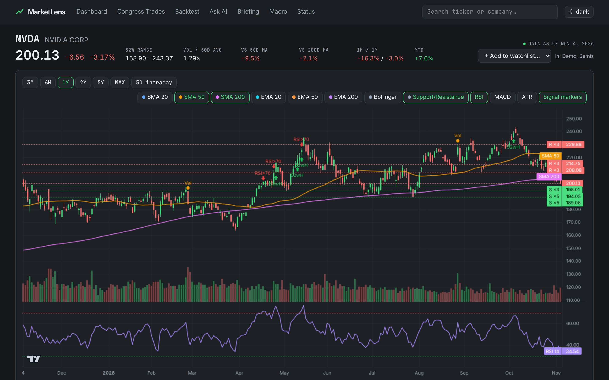
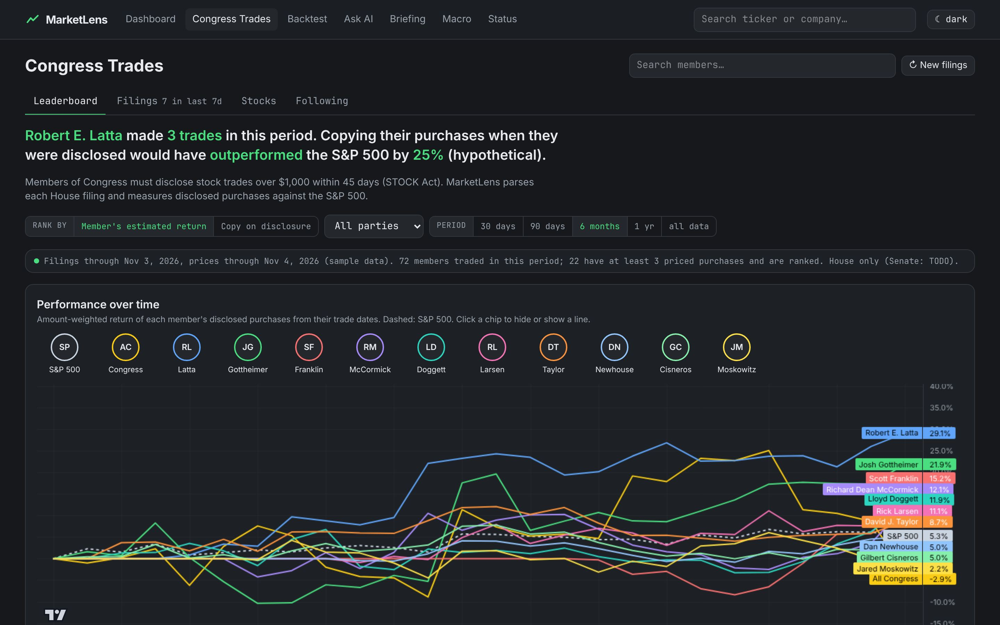
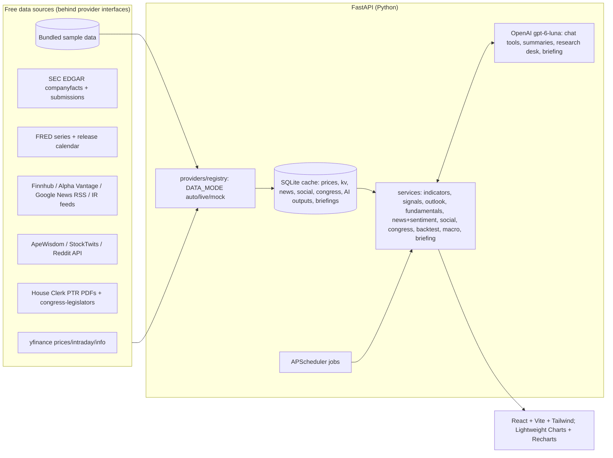

# MarketLens

A local US stock & ETF market analyzer: watchlists, interactive charts with technical indicators, rule-based
signals and a **scenario outlook**, SEC fundamentals and filings, news and crowd sentiment, backtesting,
**Congress trades**, a daily AI briefing, an Ask-AI chat and a multi-agent **AI Research Desk**.

> **Not financial advice.** MarketLens is a personal research tool. It never places trades and never tells you
> to buy or sell. Signals describe chart patterns, outlooks describe dated catalysts and historical base rates,
> backtests are hypothetical, and AI output is labeled AI-generated. Free data is **delayed, unofficial and
> rate-limited**.



| Ticker page | Congress trades |
|---|---|
|  |  |

## Quick start (Docker)

Requirements: Docker with Compose v2.24+.

```bash
make run      # creates .env from .env.example if missing, builds and starts http://localhost:8000
```

```bash
make demo     # loads the sample watchlist (SPY QQQ AAPL MSFT NVDA AMD GOOGL AMZN) + a "Semis" list, warms every page
```

```bash
make test     # runs the test-suite inside the container: offline, bundled sample data, no keys
```

Other targets: `make logs`, `make stop`, `make restart`, `make finbert` (local FinBERT sentiment, ~2 GB), `make fixtures`
(re-capture the bundled sample data from the live sources).

Everything works **without any API keys**. Prices, news (Google News RSS), Reddit mention ranks, StockTwits, House disclosures and FRED series are all free and keyless.
SEC EDGAR needs only a contact User-Agent. AI features show an "add an API key" message until `OPENAI_API_KEY` is set.

### `.env` keys

| Key | Needed for | Where to get it |
|---|---|---|
| `OPENAI_API_KEY` | Filing/news summaries, Ask AI, Research Desk, AI-written briefing (model **gpt-6-luna**) | platform.openai.com |
| `SEC_USER_AGENT` | Live fundamentals & filings (EDGAR requires `Your Name you@example.com`) | none needed, just your contact |
| `FRED_API_KEY` | Macro **release calendar** (CPI, jobs, GDP dates); series work without it | fred.stlouisfed.org/docs/api/api_key.html |
| `FINNHUB_API_KEY` / `ALPHA_VANTAGE_API_KEY` | Extra company news | finnhub.io/register, alphavantage.co |
| `REDDIT_CLIENT_ID` / `REDDIT_CLIENT_SECRET` | Reddit posts in the Crowd tab (mention ranks work without) | reddit.com/prefs/apps, "script" app |
| `SMTP_*`, `BRIEFING_EMAIL_TO` | Emailing the daily briefing | your mail provider |
| `DATA_MODE` | `auto` (default: live, falls back to sample data), `live`, `mock` | |
| `BRIEFING_TIME`, `TIMEZONE` | Weekday briefing time (default 07:30 America/New_York) | |

Restart after editing `.env`: `make restart`.

## Features

- **Dashboard**: market strip (SPY, QQQ, IWM, DIA, VIX, 10Y) with sparklines and a sector ETF heatmap (1D/1W/1M/YTD). The **multiple watchlists** table has search-to-add, price, day %, volume vs average, 52-week range position, RSI, distance from 50/200-day MAs, next earnings (Yahoo, or estimated from EDGAR) and 7-day news sentiment.
- **Ticker page**
  - **Chart**: TradingView Lightweight Charts with volume and toggleable SMA/EMA 20/50/200, Bollinger, RSI, MACD, ATR panes, support/resistance levels and signal markers. A 5-day intraday view adds VWAP.
  - **Signals & Outlook**: golden/death cross, RSI 70/30, MACD crossovers, 52-week breakout/breakdown, 200-day crosses and unusual volume, each with its rule and trigger date. The **scenario outlook** replaces "buy/sell dates":
    - dated catalysts (earnings, FOMC, CPI with a FRED key, options expiration)
    - the next-session close that would trigger each rule
    - this ticker's historical base rates after each signal vs all days
    - past earnings reactions
    - bull and bear observations with dates and sources
  - **Fundamentals**: SEC EDGAR revenue, EPS, margins, FCF, debt vs cash and share count (quarterly/annual charts); P/E, forward P/E, P/S, EV/EBITDA, PEG and FCF yield; a peer comparison table.
  - **Filings**: 10-K/10-Q/8-K list with item names and links, plus an AI summary of the latest 10-Q/10-K (labeled AI-generated).
  - **News & Sentiment**: headlines with per-article sentiment (local FinBERT or lexicon), a 7/30/90-day sentiment trend over price, spike flags, and an AI narrative with numbered links to every source.
  - **Crowd (Reddit/StockTwits)**: r/wallstreetbets and all-subreddit mention ranks, StockTwits bull/bear tags and recent posts. All of it is labeled as unverified crowd opinion.
  - **Congress**: disclosed House trades in this stock.
  - **AI Research Desk**: five analyst agents (technical, fundamentals, news, crowd, Congress), a bull-vs-bear debate, three risk lenses and a research-manager memo with dates and levels to watch. There is **no rating**. The pattern is adapted from [TauricResearch/TradingAgents](https://github.com/TauricResearch/TradingAgents) (Apache-2.0).
- **Congress Trades**
  - **Leaderboard**: member's estimated return (from the trade date) and copy-on-disclosure return vs the S&P 500, win rate, filing time and money traded; filters for party and period.
  - **Performance-over-time chart** with toggleable member chips.
  - **Member pages**: holdings estimate, stat cards, a trades vs disclosures timeline, and a trade table with prices and performance since the trade and since the disclosure.
  - Latest filings, most-traded stocks, and members you follow.
- **Backtest**
  - Presets: SMA crossover, RSI mean reversion, MACD trend, Donchian breakout, buy-and-hold. You can also write your own Python `Strategy` class, which is checked for look-ahead.
  - Fills at the **next open**, with commission (% plus fixed) and slippage; benchmark is SPY buy-and-hold.
  - Results: CAGR, Sharpe, Sortino, max drawdown, win rate, profit factor, trade count and exposure; equity, drawdown and trade list.
  - Robustness: parameter-sweep heatmap, train/test split and anchored walk-forward, with an overfitting warning. Every result is labeled hypothetical.
- **Ask AI**: OpenAI function calling (gpt-6-luna) over 15 MarketLens tools. Answers cite sources, show data dates and can include inline charts and tables. "Should I buy X?" gets the data, the bull and bear cases and the catalysts, never a recommendation.
- **Briefing**: generated each weekday morning from a snapshot of the app's data. It covers index moves, yields, VIX, sector leaders and laggards, the biggest movers with linked headlines, new signals, this week's earnings and macro events, new filings, and Congress disclosures. It keeps a history and can be emailed via SMTP.
- **Macro**: fed funds, 2Y/10Y yields, the 10Y−2Y curve, CPI YoY and unemployment from FRED, plus upcoming macro events.
- **Status**: data mode, which keys are set (with links), the scheduled jobs (with Run now), and cache freshness by source.
- Light and dark mode, responsive for laptop and tablet, and a "data as of" stamp on every page.

## Architecture



- `backend/app/providers/`: one class per source behind the Protocols in `base.py`. To use a paid API (Polygon, FMP…), implement the Protocol and change the factory in `registry.py`.
- `backend/app/services/`: all logic, cached in SQLite, with `as_of` / `source` metadata on everything.
- `backend/fixtures/`: real data captured by `scripts/capture_fixtures.py`, used for tests, `DATA_MODE=mock` and fallback.
- `frontend/src/`: pages and ticker tabs. The built app is served by FastAPI from a single container.

## Data-source limits

- **Prices (yfinance)** are unofficial Yahoo scraping. Daily bars are end-of-day and intraday is delayed ~15 minutes. It is rate-limited and can break without notice. MarketLens batches requests (40 tickers), retries with exponential backoff, caches everything and refreshes incrementally. Quote info (forward P/E, earnings calendar) is often refused ("Invalid Crumb"); next earnings then falls back to an **estimate** from EDGAR 8-K Item 2.02 history, labeled "est.".
- **SEC EDGAR** allows at most 10 requests/second and requires a User-Agent with contact info. XBRL data appears when filed (days after earnings). Q4 values are derived (FY − 9M), and derived EPS is approximate.
- **FRED** without a key uses the public CSV. CPI and unemployment are monthly with a lag.
- **News**: free tiers are limited (Finnhub 60/min; Alpha Vantage 25/day). Google News RSS covers about 30 days. Only headlines, snippets (≤280 characters) and links are stored; full articles are never stored or shown.
- **Crowd**: ApeWisdom and StockTwits endpoints are public but unofficial. Reddit needs free app credentials.
- **Congress**: House PTRs only. Scanned paper filings can't be parsed (they're linked instead). Disclosures lag trades by up to 45 days. The Senate is TODO. Returns are hypothetical, weighted by amount-range midpoints.
- Sample data in the repo is a snapshot from **2026-11-04/05**.

## How to verify

Start with `make run` and then `make demo`, and open http://localhost:8000.

1. **Dashboard**
   - Check the six index cards and the sector heatmap. Click **1W / 1M / YTD** on the heatmap to re-sort.
   - In *Watchlists*, click **Demo** and **Semis**. Click column headers to sort. Each row should show the "data as of" date.
   - Type `TSLA` in *Add ticker to this watchlist…*, press Enter, then remove it with **✕**.
   - Click **+ New watchlist**, then **Rename** and **Delete** it.
2. **Ticker page and chart**: click **NVDA**.
   - Toggle **SMA 20 … ATR** and **Signal markers**, and switch ranges **3M → MAX**.
   - Click **5D intraday** to see 5-minute bars with the orange VWAP.
3. **Signals & Outlook tab**
   - Left panel: the current state plus dated signals, each with its rule.
   - Right panel: *Dates to watch* (earnings, FOMC, options expiration), *Trigger levels* around the last close, *Historical base rates* (switch **5 / 20 / 60 trading days**), and the bull and bear cases.
4. **Fundamentals tab**: switch **quarterly / annual** and check the ten valuation cards, the six charts and the *Peer comparison* table. Open the **SPY** ticker page to see the "no SEC company facts" message for ETFs.
5. **Filings tab**: filter **10-K / 10-Q / 8-K** and click a filing to open it on sec.gov. Click **Summarize 10-Q with AI**; you'll get the "Add an API key" card if there's no key.
6. **News & Sentiment tab**: switch the trend between **7D / 30D / 90D** and click a headline to open its source. Click **Summarize recent headlines** (needs a key); the [n] links go to the articles.
7. **Crowd tab**: r/wallstreetbets rank, the StockTwits bull/bear bar and recent posts.
8. **Congress tab** on NVDA lists member trades. **AI Research Desk tab**: click **Run research desk** (needs a key, ~1 min), then switch between *Memo / Analyst reports / Bull vs bear / Risk lenses*.
9. **Congress Trades page**
   - Read the headline sentence. Switch *Rank by*, *All parties* and the period (**30 days … all data**), and click chips above the chart to hide lines.
   - Click a member row to open their page: stat cards, the timeline (**Monthly / Daily**), the sortable trade table and **+ Follow**.
   - Back on the Congress page, check the **Filings**, **Stocks** and **Following** tabs. **↻ New filings** fetches new House PDFs in the background (live mode).
10. **Backtest**
    - Run **SMA crossover** on AAPL: equity vs SPY, drawdown, metrics and the trade list, under the "Hypothetical" banner.
    - Set Commission % to 0.5 and run again to see fees reduce the result.
    - Click **Run sweep** for the heatmap, then **Walk-forward test** for in-sample vs out-of-sample results and the folds.
    - Choose **Custom Python class**, run the template, then change it to use `df["close"].shift(-1)`: the run is rejected with "Look-ahead detected".
11. **Ask AI** (needs a key): click the example *Compare NVDA and AMD on margins and valuation*, then expand **data lookups · sources · data as of**. Ask *Should I buy MSFT now?* and check the answer explains the tradeoffs without a recommendation. Ask *Chart AAPL vs MSFT over 3 months* for an inline chart.
12. **Briefing**: click **Generate now**. The result is template-based without a key and AI-written with one. Check the history list on the left.
13. **Macro**: six indicator cards, the rates chart, curve/CPI/unemployment charts, and upcoming events. Switch **1Y / 5Y / 10Y**.
14. **Status**: key checklist with links, scheduled jobs (**Run now**), and cache freshness by source. Toggle **dark/light** in the header.
15. **Live mode on your machine**: set `SEC_USER_AGENT` (and optionally `FRED_API_KEY`, `FINNHUB_API_KEY`) in `.env`, run `make restart`, then on any ticker page check that the "data as of" badge no longer says *sample data*.

## Tests

`make test` runs about 80 tests, offline and with no keys:
- **Indicators**: against StockCharts reference values (RSI, EMA), plus hand-calculated ATR, Bollinger and VWAP checks, and causality checks.
- **Backtests**: no look-ahead (next-open fills, truncation invariance, a perfect-foresight signal can't profit), exact fee and slippage math, metrics, look-ahead rejection for custom code, and walk-forward folds that don't overlap.
- **EDGAR**: parsing of Apple's saved company-facts fixture, matching reported FY2024 figures and the derived Q4.
- **Chat**: tool-call schemas valid for OpenAI strict mode, every tool running on sample data, and the tool loop with a fake client.
- **Others**: signals, outlook trigger math, news and sentiment, crowd, House PTR parsing, the Congress maths, the briefing, the scheduler and the API endpoints.

## Project layout

```
backend/app/{providers,services,api}   FastAPI app
backend/fixtures/                       bundled real sample data
backend/scripts/{demo,capture_fixtures}.py
backend/tests/
frontend/src/{pages,components}         React app
config/                                 macro calendar, optional IR feeds
DECISIONS.md                            every design decision and why
```

See **DECISIONS.md** for design decisions and **TODO** below for what's left.

## TODO

- Senate trades (the eFD site needs a terms-acceptance session; scraper not written).
- Verify `make finbert` end to end (the code path is in place; the ~2 GB PyTorch install wasn't run in the build sandbox).
- Forward P/E and earnings dates depend on Yahoo quote info, which is often blocked; a keyed provider (e.g. Finnhub earnings calendar) could replace it.
- Company IR RSS feeds: `config/ir_feeds.json` is empty by default; add `{ "AAPL": "https://…/rss" }` entries.
- Sentiment history builds up over time (free news only goes back about 30 days).
